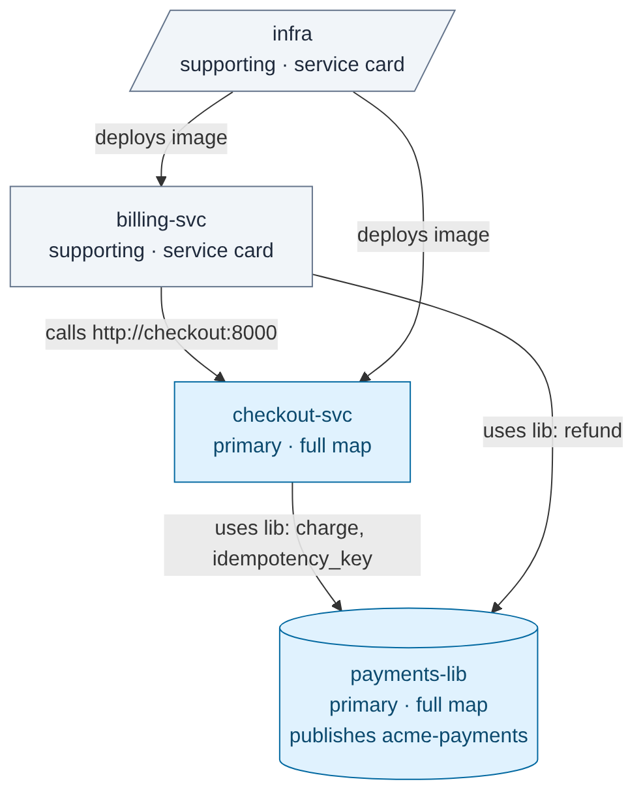

# In depth: how repo-aware-hiring understands your code and works with you

[← Back to the README](../README.md)

- [The codebase map](#it-understands-your-codebase-first)
- [Several repos](#several-repos-it-maps-how-they-connect)
- [The focus prompt](#tell-it-what-to-focus-on)
- [Questions and decisions](#you-decide-at-every-stage)

## It understands your codebase first

Before any posting, rubric or interview question, `map-codebase` builds a map of the whole system. A script
inventories the repo first, so nothing is missed: every package and service, pipeline, migration folder, deployment
file, auth module, data store and test setup. Then the agent investigates each area and writes
`hiring/_repo/codebase-map.md`:

| Area | What the map records, with file paths |
|---|---|
| Components and services | Every package and service, its entry point, how they talk to each other |
| Data stores and schema | Databases, caches, queues; ORM, main entities, how migrations are written and applied |
| APIs and integrations | REST/GraphQL/gRPC, generated clients, external services |
| Authentication and security | Login and tokens, password storage, permissions, secrets handling, scanning |
| CI/CD pipeline | Every workflow: triggers, gates, releases and deployments |
| Deployment and infrastructure | Containers, proxies and TLS, environments, IaC, backups |
| Observability, testing, dependencies, conventions | Logging and errors, test types and setup, key libraries, code standards |
| Hot spots and risks | Fragile areas and missing safeguards, marked **INTERNAL: never published** |

Every other skill runs `check_map.py` first and refuses to start until the map is complete and current:

```text
FAIL codebase map hiring/_repo/codebase-map.md
  error: compose service 'adminer' is not described in Components or Deployment
  error: inventory detected Sentry (observability) but 'Observability' doesn't mention it
  error: STALE: the codebase changed since the map was written. Changed: ~.github/workflows/test-backend.yml
```

The map is built once per repository and reused for every role. It never reads `.env` files, and blocks secrets
copied into it. Read the real map of the demo repo: [`docs/example-codebase-map.md`](example-codebase-map.md).


## Several repos? It maps how they connect

Most hires work across more than one repository: a few services, a shared library, an infrastructure repo.
The `hiring-workspace` skill keeps them in one private folder outside all of them (local paths or git URLs), and:

- **scans every repo** and finds the links from the code itself: packages one repo publishes and others depend on,
  container images built in one repo and deployed from another, services calling each other's hostnames, shared API
  contracts, and services generated from the **same template**;
- **maps at the right depth**: a full codebase map for the repos the hire will mainly work in, a shorter
  *service card* for the ones that only matter for context;
- writes a **system map** that must explain every link, and goes stale when any repo changes.

<p align="center">
  
</p>

```text
$ workspace.py scan ~/hiring/payments
System graph e5a4d9d6b8ba79a8: 4 repos, 5 links
  checkout-svc -[package]-> payments-lib: depends on acme-payments
  billing-svc -[package]-> payments-lib: depends on acme-payments
  infra -[image]-> checkout-svc: deploys image ghcr.io/acme/checkout
  billing-svc -[http]-> checkout-svc: calls http://checkout:8000 (Service declared in infra)
  same template: billing-svc, checkout-svc (similarity 1.0)
```

One repo? Nothing changes: everything still works inside `hiring/` in that repo.
Example: [`docs/example-system-map.md`](example-system-map.md).


## Tell it what to focus on

Write what matters in plain words, once per role:

> *Focus on the payment library and its application in the two repositories, as the new hire will work on the
> payment system.*

Every step reads it: the profile ranks the payment problems first, the rubric weights them, and interview questions
start there. When the focus names a library, a tracer finds where it's defined and every place it's used:

```text
| Repo         | Declared | Import sites | Symbols used | Call sites |
| checkout-svc | 1        | 1            | 2            | 2          |
| billing-svc  | 1        | 1            | 1            | 1          |
checkout-svc  charge ×1 app/api/orders.py:17 · idempotency_key ×1 app/api/orders.py:15
billing-svc   refund ×1 app/api/invoices.py:14
Public symbols nobody outside the library calls: Charge, PaymentClient
```

The focus describes the **work**, never the person: *"young"*, *"top universities"* or *"native speaker"* are
rejected, and so is anything that tries to switch off redaction or the rubric. *"Race conditions"* and
*"React Native"* are fine. Each output records the focus version it used, so changing the focus shows what to redo.


## You decide at every stage

Each stage asks at most three questions, one at a time, about things only you know or that would be costly to get
wrong. Nothing is chosen for you: no option is pre-selected or labelled "recommended", each says what it's based
on, and you can always write your own answer or skip.

```text
Rubric · question 1 of 3
How should the work split across the repos?
  A) payments-lib 50% · checkout-svc 30% · billing-svc 20%
     (the focus names the payment library; checkout charges, billing refunds)
  B) Equal across the three repos
  C) Write my own answer
  D) Skip
```

Answers go into a decisions log, so nothing is asked twice. A skipped question is recorded as **none**, and nothing
is guessed in its place: the job description gets an `[insert: …]` placeholder, the rubric uses no scope weights,
screening ranks everyone. You can answer it later and redo what depends on it. A skip never approves anything: the
rubric still waits for you, and nothing is deleted without your answer. Interview panels work the same way: say who
asks about what, and each kit shows every interviewer their questions.

