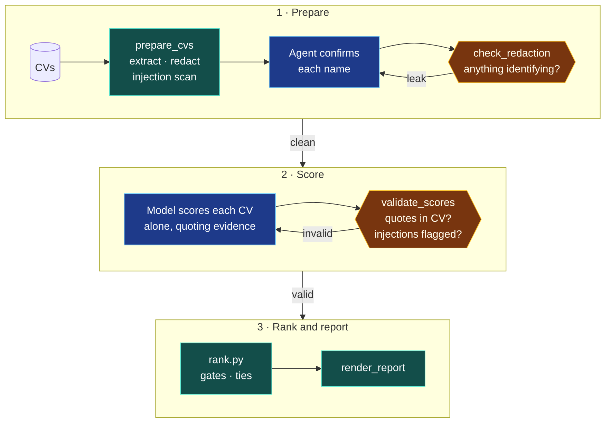

# Safeguards in detail

[← Back to the README](../README.md)

The model does what it's good at: understanding code and CVs. Everything that can be checked by a
script *is* checked by a script, and each check blocks the next step until it passes.

  

🔵 model step · 🟢 deterministic script · 🟠 blocking check

| Safeguard | How it works |
|---|---|
| **Redaction before scoring** | Names, contact details, links, date of birth, age, nationality, marital status, gender and religion are removed. Field labels are detected in English, French, German, Spanish, Italian, Dutch and Portuguese. Each candidate's name must be confirmed before scoring can start. |
| **Evidence or zero** | Every score quotes the CV. `validate_scores.py` rejects any quote it can't find in that CV, so the model can't invent experience. |
| **Independent scoring** | Each CV is scored alone against the rubric. Candidates are never compared while scoring, which avoids order and anchoring effects. |
| **Deterministic ranking** | Totals, must-have gates and ties are computed by code, not the model, and are reproducible. |
| **Bias tests** | The eval suite checks that swapping a candidate's name, gender or national origin produces identical redacted text, and that a university change or a career break doesn't move the score. |
| **Injection defence** | Instructions hidden in CVs (including white text in PDFs, in several languages) are detected, flagged for a human, and ignored. |
| **Human approval** | No scoring until a named person approves the rubric. Nothing is ever rejected automatically. |
| **Whole-system understanding** | A deterministic inventory plus a 13-section map with file citations; `check_map.py` blocks every other skill until everything found is explained and the map matches the current code. |
| **Safe job postings** | `check_jd.py` blocks file paths, internal names from your repo, environment variables, hosts and security weaknesses from public job descriptions. |
| **Fair interviews** | Interview kits use the same core questions for everyone; `validate_kit.py` blocks questions about protected characteristics, invented CV claims and leaked internals. |
| **Safe report file** | `report.html` makes no network requests and escapes all CV text, so it can be opened and shared without leaking data or running injected code. |
| **Retention** | `close-round` deletes candidate data, including both reports, when a role closes and keeps only a pseudonymous audit record. |

139 deterministic checks run in CI on every push (`python3 evals/selftest.py`). See
[`evals/`](../evals/README.md) for the full harness, including multi-session model evals.

