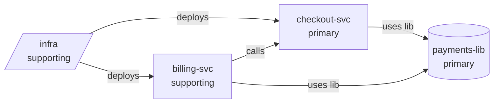

# Example: a system map across four repos

This is the output of the `hiring-workspace` skill on the synthetic fixture in
[`evals/fixtures/multi-repo/`](../evals/fixtures/multi-repo): a shared payments library, two services built from one
template, and an infrastructure repo. Run it yourself:

```bash
W=skills/hiring-workspace/scripts
python3 $W/workspace.py init /tmp/acme-ws
for r in payments-lib checkout-svc; do python3 $W/workspace.py add /tmp/acme-ws evals/fixtures/multi-repo/$r --tier primary; done
for r in billing-svc infra; do python3 $W/workspace.py add /tmp/acme-ws evals/fixtures/multi-repo/$r --tier supporting; done
python3 $W/workspace.py scan /tmp/acme-ws
python3 $W/trace_usage.py /tmp/acme-ws payments-lib
```

The system map below is written by the agent from the generated graph; `check_system.py` checks that it describes
every repo and explains every link, and that it is current.

---

## System map — acme
Graph: e5a4d9d6b8ba79a8 · Generated: 2026-11-08 · Repos: 4

### Overview
Two FastAPI services (checkout-svc, billing-svc) built from the same template, a shared payments library
(payments-lib, published as acme-payments) that both use to talk to the payment provider, and an infra repo
that deploys both services to Kubernetes. The payment flow crosses all four repos.

### Repositories
| Repo | Tier | Role | Map |
|---|---|---|---|
| payments-lib | primary | library: charges, refunds, idempotency | full map |
| checkout-svc | primary | service: places orders and charges | full map |
| billing-svc | supporting | service: invoices and refunds | service card |
| infra | supporting | deploys checkout and billing to Kubernetes | service card |

### Connections
- checkout-svc → payments-lib: depends on acme-payments 2.3.0; calls `charge` and `idempotency_key` when placing an order.
- billing-svc → payments-lib: depends on acme-payments 2.3.0; calls `refund` for invoice refunds.
- billing-svc → checkout-svc: HTTP call to http://checkout:8000 to look up the order for a charge; the hostname is the
  Kubernetes Service declared in infra. No authentication between the services.
- infra → checkout-svc: deploys image ghcr.io/acme/checkout built by checkout-svc's CI.
- infra → billing-svc: deploys image ghcr.io/acme/billing built by billing-svc's CI.
- payments-lib publishes to the internal package index pypi.acme.internal (not a repo in this workspace).

### Shared code and templates
checkout-svc and billing-svc share one template (same layout, FastAPI + SQLAlchemy + Alembic, same CI and Dockerfile);
checkout-svc's full map explains the shared structure and billing-svc's card lists only differences. Shared code is
the acme-payments package, versioned and pinned to the same release in both services.

### Ownership and team boundaries
Unknown: the hiring manager hasn't said who owns each repo. Assumed for now that the payments team owns payments-lib
and checkout-svc, and a platform team owns infra (recorded as assumptions in decisions.json).

### Gaps
Where PostgreSQL runs and how provider credentials reach the services are not visible in any repo here.
The endpoint billing-svc calls on checkout-svc does not exist yet in checkout-svc.

---

## The generated graph
Graph: e5a4d9d6b8ba79a8 · Generated: 2026-11-08T12:36:23+00:00



| From | Kind | To | Detail | Evidence |
|---|---|---|---|---|
| checkout-svc | package | payments-lib | depends on acme-payments | `payments-lib:pyproject.toml`, `checkout-svc:requirements.txt` |
| billing-svc | package | payments-lib | depends on acme-payments | `payments-lib:pyproject.toml`, `billing-svc:requirements.txt` |
| infra | image | billing-svc | deploys image ghcr.io/acme/billing | `infra:k8s/billing.yaml`, `billing-svc:.github/workflows/ci.yml` |
| infra | image | checkout-svc | deploys image ghcr.io/acme/checkout | `infra:k8s/checkout.yaml`, `checkout-svc:.github/workflows/ci.yml` |
| billing-svc | http | checkout-svc | calls http://checkout:8000 (Service declared in infra) | `billing-svc:app/api/invoices.py` |

### Same template
- billing-svc, checkout-svc: layout similarity 1.0, frameworks FastAPI. Map the shared structure once; describe only differences.

### Internal hosts not matched to a repo in the workspace
- payments-lib calls `pypi.acme.internal` (.github/workflows/publish.yml); maybe a repo that isn't in the workspace, or an external dependency

---

## How `payments-lib` is used

Defined in **payments-lib**. Import names: `acme-payments`, `acme_payments`.
Public symbols (5): `Charge` (src/acme_payments/client.py:9), `PaymentClient` (src/acme_payments/client.py:16), `charge` (src/acme_payments/client.py:43), `idempotency_key` (src/acme_payments/idempotency.py:5), `refund` (src/acme_payments/client.py:47)

| Repo | Declared | Import sites | Symbols used | Call sites |
|---|---|---|---|---|
| checkout-svc | 1 | 1 | 2 | 2 |
| billing-svc | 1 | 1 | 1 | 1 |
| infra | 0 | 0 | 0 | 0 |

### checkout-svc
- declared `requirements.txt:6`: `acme-payments==2.3.0`
- import `app/api/orders.py:1`: `from acme_payments import charge, idempotency_key`
- **charge** ×1: `app/api/orders.py:17`
- **idempotency_key** ×1: `app/api/orders.py:15`

### billing-svc
- declared `requirements.txt:6`: `acme-payments==2.3.0`
- import `app/api/invoices.py:3`: `import acme_payments`
- **refund** ×1: `app/api/invoices.py:14`

### Public symbols nobody outside the library calls
`Charge`, `PaymentClient`
